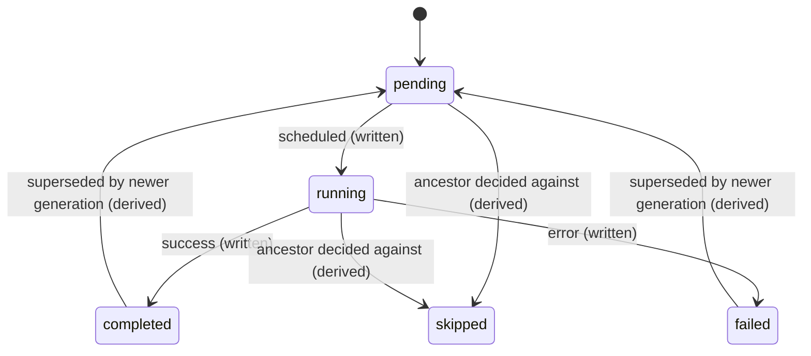

# pg_durable — Upstream Documentation Notes

Fetched live from `microsoft/pg_durable` on GitHub (`main` branch, HEAD `76a36aabb14a1fb8b674c1fd99044ad59e2aba53`) via `raw.githubusercontent.com` and the GitHub API — not from training data. Current released version at fetch time: **v0.2.5** (2026-07-30); `main` is mid-development on **v0.2.6 (Unreleased)**.

> **Important calibration note on sources.** This repo contains two layers of documentation that disagree in places:
> - **Authoritative / current-behavior docs:** `USER_GUIDE.md`, `docs/api-reference.md`, `docs/ARCHITECTURE.md`, `docs/http-security.md`, `docs/rls.md`, `docs/superuser_guc.md`, `docs/user-isolation.md`, `docs/bgw-applies-migrations.md`, `docs/upgrade-testing.md`, `docs/multi-database.md`, `docs/named-results-v2.md`, `CHANGELOG.md`, and the packaged agent skill `.agents/skills/pg-durable-sql/SKILL.md`. These describe what is actually shipped.
> - **Superseded / aspirational / proposal docs:** `docs/pg_durable_spec.md` (the *original* pre-implementation design — uses a `durable.*` schema, UUID node IDs, `duro_nodes`/`duro_instances`/`duro_triggers`/`duro_history` tables, an *external* Rust runtime process, and DSL features like `for_each`/`case_when` that were never shipped), `docs/spec-http-support.md` (describes a `fail_on_5xx` parameter that does not exist in the shipped `df.http()`), `docs/spec-compensation.md` (status: **Proposal** — the `<->`/`df.with_undo()` saga/compensation feature is **not implemented**; absent from `USER_GUIDE.md`'s DSL reference and from `CHANGELOG.md`), and `docs/move-duroxide-schema.md` (a design doc — but I confirmed via `CHANGELOG.md` v0.2.3 entry that this one **did ship**). Where a spec doc conflicts with the authoritative docs, I've flagged it and gone with the authoritative source.

---

## 1. DSL Semantics

Source: `USER_GUIDE.md` §"DSL Reference"/"Condition Evaluation", `docs/api-reference.md`, `docs/ARCHITECTURE.md`, `.agents/skills/pg-durable-sql/SKILL.md`, `docs/nested-graph-design.md`.

### Core model
Every `df.*` DSL function and operator is **pure, in-memory graph construction** — it returns a JSON-encoded `TEXT` string (a `Durofut`) and performs **no database writes**. Only `df.start()` materializes the graph into `df.nodes` rows. This is a deliberate redesign (`docs/nested-graph-design.md`) away from an earlier approach where DSL calls inserted rows immediately (which left orphaned rows for graphs that were never started).

```rust
pub struct Durofut {
    pub node_type: String,                     // SQL, THEN, IF, JOIN, LOOP, SLEEP, SIGNAL, HTTP, ...
    pub left_node: Option<Box<RawValue>>,
    pub right_node: Option<Box<RawValue>>,
    pub condition_node: Option<Box<RawValue>>,  // first-class child for IF/LOOP conditions
    pub extra_nodes: Vec<Box<RawValue>>,        // first-class children for extra JOIN branches
    pub query: Option<String>,
    pub result_name: Option<String>,
}
```
Children are stored as opaque `RawValue` and parsed one level at a time by `flatten_graph` (shared by `df.start()` and `df.explain()`), which avoids `serde_json`'s ~127-level recursion ceiling and enforces the graph-depth limit (see below). This envelope is **internal and unversioned** — do not persist it across releases.

### Auto-wrap
A plain SQL string is automatically wrapped as a `df.sql()`/`SQL` node. Detection: valid JSON with a recognized `node_type` → treated as an existing Durofut node; otherwise → wrapped as `SQL`. `Durofut::ensure()` now (v0.2.6, unreleased) fails loudly if a JSON object *does* carry a `node_type` but can't be deserialized, rather than silently degrading to a raw SQL string that would only fail at execution time.

### Operators (SQL custom operators, `TEXT ⊗ TEXT → TEXT`)

| Op | Calls | Meaning |
|---|---|---|
| `~>` | `df.seq(a,b)` | sequence (then) |
| `\|=>` | `df.as(fut,name)` | bind/name a result |
| `&` | `df.join(a,b)` | parallel, wait for all |
| `\|` | `df.race(a,b)` | parallel, first wins (abandons the other) |
| `?>` | (paired with `!>`) `df.if(cond,then,...)` | if-then |
| `!>` | | if-then-else (else branch) |
| `@>` | `df.loop(body)` | **prefix** operator — infinite loop only; `@> body`, not `body @>` |

`@>` does not itself make a loop the graph *root* — `df.seq('SELECT setup()', @> 'SELECT work()')` is non-root because the sequence is the root (matters for execution-context rules, see §3).

A `<->`/`df.with_undo()` saga-compensation operator with its own precedence tier is **proposed only** (`docs/spec-compensation.md`, status "Proposal", Dec 2025) — not shipped.

### Functions (representative; full list in `docs/api-reference.md`)

- `df.sql(query)` — SQL node (rarely needed directly; auto-wrap covers it).
- `df.seq(a,b)`, `df.as(fut,name)`, `df.join(a,b)`, `df.join3(a,b,c)`, `df.race(a,b)`.
- `df.if(cond,then,else)` — condition is itself a node (SQL query by default).
- `df.if_rows(result_name, then, else)` — branches on whether an **already-captured** named result has rows, without executing an extra SQL query. `result_name` is a literal (no `$`), not auto-wrapped.
- `df.loop(body)` / `df.loop(body, condition)` — infinite or while-loop; condition is evaluated *after* each iteration.
- `df.break()` / `df.break(value)` — exits the enclosing loop. **`value` is NOT auto-wrapped as SQL** — it's a literal JSON/text value returned verbatim as the loop's result. This is the one place DSL functions deliberately break the "auto-wrap children" rule.
- `df.sleep(seconds)`, `df.wait_for_schedule(cron_expr)`, `df.wait_for_signal(name[, timeout_seconds])`.
- `df.http(url, method='POST', body=NULL, headers='{}'::jsonb, timeout_seconds=30)` and `df.http_multipart(url, method='POST', parts='[]'::jsonb, headers, timeout_seconds)` (added v0.2.5) — both literal-only args (no auto-wrap), gated behind `include_http => true` grant.
- `df.start(fut, label=NULL, database=NULL, transaction_mode='caller')` — the only function that triggers execution.

**Auto-wrap matrix:** `fut`-shaped params (`a`,`b`,`c`, `cond`/`then`/`else`, `body`/loop-`condition`, `df.start(fut,...)`) auto-wrap plain SQL strings into `df.sql()` nodes. Literal/config params (names, URLs, timeouts, cron strings, `df.break(value)`) never do.

### Graph depth limit
A workflow graph may nest at most **256** composition levels; `df.start()` and `df.explain()` both reject deeper graphs with a max-nesting-depth error. Split large workflows into sub-workflows.

### `df.vars` — per-user configuration variables (`{name}` interpolation)
Distinct system from result-capture. Set with `df.setvar(name, value)` **before** `df.start()`; captured as an immutable snapshot at start time; cannot be mutated from inside a running workflow (`df.in_workflow = 'true'` connection setting blocks `setvar`/`unsetvar`/`clearvars` during execution — `docs/user-isolation.md`).

- **Per-user RLS scoping** (`docs/rls.md` §4.3, implemented v0.2.0): `df.vars` schema is `(name TEXT, value TEXT, owner REGROLE NOT NULL DEFAULT current_user::regrole, PRIMARY KEY (owner, name))`, RLS policy `owner = current_user::regrole`. Superusers bypass RLS at the table level, but every `df.*` DSL wrapper (`setvar`/`getvar`/`unsetvar`/`clearvars`, and the vars-capture step inside `df.start()`) applies an **explicit** `WHERE owner = current_user::regrole` filter, so scoping is correct for superusers too — RLS is defense-in-depth for non-superusers, the explicit filter is what actually guarantees correctness for everyone.
- `df.setvar()`, `df.unsetvar()`, `df.clearvars()` are **setup helpers, not workflow nodes** — never call them inside `df.seq`/`df.join`/etc.
- System variables (read-only, always available): `{sys_instance_id}`, `{sys_label}`.
- **Substitution is raw text substitution, unescaped, by design** (so variables can hold SQL fragments like table names) — never put untrusted external input into a `df.setvar()` value that gets spliced into SQL.

### Variable interpolation (`$name` result-capture family) — `docs/named-results-v2.md`, `USER_GUIDE.md`
Four substitution forms on a result bound via `|=>`:

| Pattern | Behavior | No rows | NULL |
|---|---|---|---|
| `$name` | first column of first row | **fails instance** | **fails instance** |
| `$name.column` | named column of first row | **fails** | **fails** |
| `$name?` | null-safe scalar | → `NULL` | → `NULL` |
| `$name.column?` | null-safe column | → `NULL` | → `NULL` |
| `$name.*` | **row-set expansion**: generates an inline `(VALUES (...),(...)) AS name(col1,col2,...)` subquery, usable in a `FROM` clause | empty relation | n/a |

Substitution is by exact `$name` text match against the query template — `$name` and `$name.col` etc. are distinguished by what follows the identifier. Values inside `df.http()`/`df.http_multipart()` `data_b64` fields have a special rule: **whole-value-only substitution** — `'data_b64', '$pdf.body'` is fine, `'data_b64', 'prefix$pdf.body'` is a **node failure** (splicing into the middle of base64 can't produce valid base64, so pg_durable refuses rather than uploading corrupt data). Every other HTTP field (url, headers, part `name`/`filename`) interpolates normally, including partial-string splicing.

Three substitution passes happen at execution time (not at graph-construction time), documented order: (1) `{sys_*}` system vars, (2) `{name}` user vars, (3) `$name` result captures.

### Condition evaluation (truthiness) — used by `?>`/`!>`, `df.if()`, `df.loop(body,cond)`
The **first column of the first row** of the condition's result is extracted and evaluated:

| Type | Truthy | Falsy |
|---|---|---|
| Boolean | `true`,`t` | `false`,`f` |
| Number | any non-zero | `0`, `0.0` |
| String | `'true'`,`'t'`,`'yes'`,`'1'`, any other non-empty string | `'false'`,`'f'`,`'no'`,`'0'`,`''` |
| Array | non-empty | empty `[]` |
| Object | non-empty | empty `{}` |
| NULL | — | always falsy |

Best practice per docs: use explicit booleans (`count(*) > 0`, `EXISTS(...)`) rather than relying on numeric truthiness.

### Graphs are built/registered/named — no separate "sub-function" registry
There is no persistent named-function registry distinct from an instance. Every `df.start()` call materializes a **fresh, self-contained graph** for that instance (`df.nodes` rows scoped to `instance_id`). "Sub-functions" in the runtime sense are **sub-orchestrations**, not user-registered functions: JOIN/RACE branches and non-root loops each run as an internal `execute-subtree` child orchestration (see §3) — these are implementation detail, invisible in `df.list_instances()`, and observed only through the parent instance's node tree.

---

## 2. Instance Lifecycle

Source: `USER_GUIDE.md` §"Core Concepts"/"Monitoring", `docs/api-reference.md`.

### `df.start()`
```sql
df.start(fut TEXT, label TEXT DEFAULT NULL, database TEXT DEFAULT NULL,
         transaction_mode TEXT DEFAULT 'caller') RETURNS TEXT   -- 8-hex-char instance_id
```
Auto-wraps `fut`. Returns immediately with an 8-character hex `instance_id` (does **not** block for completion — use `df.status()`/`df.await_instance()`).

**Transaction semantics** (`transaction_mode`):
- `'caller'` (default): the *start* (graph insert + instance row + duroxide enqueue) participates in the caller's own transaction. A `ROLLBACK` discards the durable function entirely — it never runs.
- `'new'`: the start commits on a **separate PostgreSQL session/transaction**, so it survives a `ROLLBACK` of the caller's transaction — same outcome as an Oracle autonomous transaction, but *only* for the launch, not synchronous execution; the workflow itself still runs asynchronously and its errors surface only via `df.status()`/`df.result()`/monitoring, not back through the `df.start()` call. Consequences: (a) the captured `df.vars` snapshot only includes *committed* vars — an uncommitted `df.setvar()` earlier in the same open caller transaction is invisible; (b) costs an extra backend connection, capped cluster-wide by `pg_durable.max_new_transaction_starts` (default 2), with callers queueing up to `pg_durable.new_transaction_start_timeout` seconds (default 5) before failing *without* opening the extra session; (c) the inner start statement is bounded by a 30s `lock_timeout`/`statement_timeout`; (d) rejected (raises) if called from *inside* a running workflow, since a `df.sql()` node already runs autocommit/independent of the caller. An unrecognized `transaction_mode` value raises rather than silently defaulting.

### `df.instances` / `df.nodes` schemas (columns)
From `docs/ARCHITECTURE.md`, `docs/rls.md`, `docs/multi-database.md`, `docs/upgrade-testing.md` (current shape, post v0.2.4 `#129` PK restructure):

**`df.instances`**
| Column | Notes |
|---|---|
| `id` | `VARCHAR(8)` hex, **primary key** (globally unique; reserved via `INSERT ... ON CONFLICT (id) DO NOTHING RETURNING id`, re-rolled on collision) |
| `label` | optional friendly name |
| `root_node` | FK to `df.nodes`, `DEFERRABLE INITIALLY DEFERRED` (checked at commit, not insert) |
| `status` | `pending`/`running`/`completed`/`failed`/`cancelled` |
| `output` | final result |
| `submitted_by` | `REGROLE NOT NULL` — captured `current_user` at `df.start()` time; drives execution identity and RLS |
| `database` | `TEXT`, nullable — target database on the same cluster; `NULL` = extension's own database (added for multi-database support) |
| `created_at`, `completed_at` | timestamps; `completed_at` stays `NULL` until status reaches `completed` (not set for `failed`/`cancelled`) |

Indexes (added v0.2.4 for #167/#87/#146): `idx_instances_status(status, created_at DESC, id)`, `idx_instances_created_at(created_at DESC, id)`, partial `idx_instances_label(label, created_at DESC, id) WHERE label IS NOT NULL`.

**`df.nodes`**
| Column | Notes |
|---|---|
| `id`, `instance_id` | composite **primary key** `(instance_id, id)` since v0.2.4 (was global-unique `id` alone before; node IDs only need per-instance uniqueness) |
| `node_type` | `SQL`,`THEN`,`IF`,`JOIN`,`RACE`,`LOOP`,`SLEEP`,`SIGNAL`,`HTTP`,`HTTP_MULTIPART`(v0.2.5),`BREAK`,... |
| `query` | SQL text for `SQL` nodes; JSON config for compound/leaf nodes (post-v0.2.6: condition/extra-branch children are opaque JSON child references, not string-embedded) |
| `result_name`, `left_node`, `right_node` | as built by the DSL |
| `status` | **physical**: `pending`/`running`/`completed`/`failed` (checked via `nodes_status_chk`; note `skipped` is never a stored value) |
| `result` | JSON text, only for terminal nodes |
| `status_details` | JSON text metadata written by the `update-node-status` activity; carries the node's `execution_id` stamp: `{instance_path}::{generation}` where `instance_path` encodes sub-orchestration lineage (`root_instance::parent_gen::branch_or_loop_node_id::...`) |
| `submitted_by`, `database` | denormalized from the instance for convenience, set at insert time |

### Status values and transitions
`pending → running → {completed | failed}`, plus `cancelled` (terminal, set by `df.cancel()`). These four/five are the only **physically stored** values. A derived, read-time-only status (`inferred_status`, surfaced by `df.instance_nodes()` and `df.explain()`, never written to `df.nodes.status`) adds:
- **`skipped`** — a node on a branch that's been decided against: untaken `df.if()` arm, right side of a failed `~>`/`THEN`, or the abandoned still-running loser of a resolved `df.race()` (a loser that had *already* reached `completed`/`failed` keeps its physical status, it doesn't become `skipped`).
- **derived `pending`** — a node from a superseded loop generation reads back as `pending` (it will re-run) rather than showing the prior iteration's stale terminal status.


This state machine is from `USER_GUIDE.md` verbatim.

### `df.cancel(instance_id, reason='Cancelled by user')`
Ownership-checked (an explicit SPI `SELECT EXISTS(...)` against `df.instances`, which goes through RLS) before the actual cancellation call to the duroxide client (which itself bypasses RLS) — this closes a gap where RLS on the SPI `UPDATE` alone would silently no-op instead of rejecting (`docs/rls.md` Decision 7). Cancellation cascades from the parent instance to active loop children; a loop that lost a `df.race()` shows as terminal `failed` with a cancellation reason (duroxide cancels the child before it can self-stamp).

### Results retrieval
- `df.result(instance_id)` — instance_id only, **not label**; returns JSON text of the final node's output.
- `df.status(instance_id)` — lowercase status string.
- To resolve a label → instance_id: `SELECT instance_id FROM df.list_instances() WHERE label = '...'` (labels are not unique across runs).
- `df.await_instance(instance_id[, timeout_seconds=30])` — blocks until completion (renamed from `df.wait_for_completion()` in v0.2.4; old name kept as a compatibility shim).

### Listing/monitoring queries
`df.list_instances(...)` has **two overloads by arity** (never ambiguous):
- Basic (0–2 args): `df.list_instances([status_filter[, limit_count=100]])` → 6 columns: `instance_id, label, function_name, status, execution_count, output`.
- Paginated (3–4 args): `df.list_instances(status_filter, limit_count, label_filter[, after_cursor])` → adds `created_at, completed_at, next_cursor`. Keyset (cursor, not `OFFSET`) pagination — `next_cursor` is identical across every row of a page, `NULL` on the final page; pass it back verbatim as `after_cursor`. A malformed cursor raises rather than silently restarting at page 1. Rows ordered `created_at DESC, id ASC`. `limit_count` is capped by GUC `pg_durable.list_instances_max_limit` (default 1000) — exceeding it **raises an error** (changed in v0.2.4; previously silently truncated to 10000).

Other monitoring: `df.instance_info(id)` (adds `function_version`, `current_execution_id`), `df.instance_nodes(id)` (full node table, see above), `df.instance_executions(id[, limit=5])` (`execution_id, status, event_count, duration_ms, output` — for loops/retries), `df.metrics()` (system-wide aggregate counts — **not** included in ordinary `df.grant_usage()`, requires an explicit admin grant, see §4).

All of the above (except `df.metrics()`) are **RLS-scoped to the caller's own instances**; superusers see everything.

### Retention/cleanup (`docs/upgrade-testing.md` doesn't cover this; from `USER_GUIDE.md` §Monitoring)
A **best-effort reconciliation pass**, driven by two Postmaster-context GUCs (`postgresql.conf`, restart required):
```ini
pg_durable.reconcile_interval = 3600   # seconds; 0 disables
pg_durable.retention_days = 30         # 0 = remove terminal instances as soon as next pass runs
```
- Removes **terminal** (`completed`/`failed`/`cancelled`) instances and their nodes past `retention_days`; running/pending instances are **never** removed regardless of age.
- Hard cap: **at most 10,000 terminal instances retained** regardless of age (fixed, not a GUC) — a terminal instance survives only while it is *both* among the newest 10,000 terminal instances *and* younger than `retention_days`.
- Age measured from `completed_at` (if set) else `created_at` — deliberately not `updated_at`, since that's user-writable.
- Also reclaims **orphaned engine (duroxide) records**: if the caller's transaction that wrote `df.instances`/`df.nodes` rolls back *after* the engine was handed the workflow (separate connection), the engine keeps an inert record with no matching `df` row; reconciliation deletes such df-less engine records once they age past `retention_days`.
- `df` state and engine state are separate stores written by separate transactions → **eventually consistent**; `df.list_instances()` can transiently show a just-terminal row with empty engine-derived columns.

---

## 3. Execution Model

Source: `docs/ARCHITECTURE.md`, `USER_GUIDE.md`, `docs/upgrade-testing.md` (v0.2.5 loop/sub-orchestration section), `docs/rls.md` Decision 6, `docs/user-isolation.md`, `docs/spec-http-support.md`, `CHANGELOG.md`.

### Background worker: embedded, not external
Despite the *original* spec (`docs/pg_durable_spec.md`) describing "a separate Rust process," the **actual shipped architecture runs everything inside the PostgreSQL server process**. A single background worker (`pg_durable_worker`, registered via `BackgroundWorkerBuilder` in `_PG_init()`, `set_restart_time(1s)`, `enable_spi_access()`) hosts the duroxide runtime with two internal dispatchers: an **Orchestration Dispatcher** and an **Activity Dispatcher**, both polling their respective work-item queues in the `duroxide`/`_duroxide` provider schema via `duroxide-pg` (sqlx-based `PostgresProvider`).

### Role requirement — superuser
`pg_durable.worker_role` (GUC, default `postgres`) **must be a PostgreSQL superuser**. Superusers bypass RLS automatically, which is *how* the worker is allowed to read/write every user's `df.instances`/`df.nodes` rows and connect as arbitrary `submitted_by` roles — no `BYPASSRLS` attribute or per-table worker policy is granted; the design relies entirely on the standard superuser bypass (`docs/rls.md` Decision 6).

### Concurrency / connection budget
No fixed "N workers" concept — concurrency is bounded by **connection-pool GUCs**, all Postmaster-context (restart required), described in `USER_GUIDE.md` §"Connection Limits":

| GUC | Default | Purpose |
|---|---|---|
| `pg_durable.max_management_connections` | 6 | graph loading, status updates, lifecycle polling |
| `pg_durable.max_duroxide_connections` | 10 | orchestration state + LISTEN/NOTIFY dispatch (min 2: worker refuses to start below this) |
| `pg_durable.max_user_connections` | 10 | concurrent **per-SQL-node** executions, authenticated as the submitting user |
| `pg_durable.execution_acquire_timeout` | 30s | how long a SQL node waits for a user-execution slot before failing |
| `pg_durable.max_new_transaction_starts` | 2 | concurrent `transaction_mode => 'new'` loopback launch sessions |
| `pg_durable.new_transaction_start_timeout` | 5s | wait for a launch slot before failing (no session opened) |

Each connected backend session also opens **+1 connection** for duroxide client operations. Backpressure is semaphore-based: excess SQL-node executions **queue**, they don't fail immediately, until `execution_acquire_timeout` expires.

### Checkpoint granularity — what's durable, and when
Every **activity** (an `ExecuteSQL`, `ExecuteHTTP`, load-graph, status-update call, etc.) is a duroxide checkpoint boundary — its result is persisted to the duroxide provider store before the orchestration proceeds. On crash/restart, the orchestration **replays** its history from the store: completed activities return their cached results instantly (not re-executed), and execution resumes exactly where it left off. This is durability-via-replay, inherited wholesale from duroxide, not a pg_durable-specific mechanism.

### Transaction boundary per step
A `SQL` node's query is executed as **a single statement over an autocommit connection**, authenticated directly as `submitted_by` (no `SET ROLE` indirection — the connection *authenticates as* that role). This is explicitly why `transaction_mode => 'new'` on a `df.start()` called *from inside* a workflow is rejected and pointless: a workflow's own `df.sql()` steps are already each independent of any enclosing transaction.

### Retry / backoff semantics
pg_durable does **not** define its own retry policy layer in the docs I found — retries are a property of **duroxide's activity execution model**, inherited as-is:
- HTTP: `docs/spec-http-support.md` (a design doc, so treat the exact `fail_on_5xx` knob it describes with suspicion — it's absent from the shipped `df.http()` 5-arg signature in `USER_GUIDE.md`/`docs/api-reference.md`) documents the *intended* behavior, confirmed consistent with the shipped docs' simpler summary: **2xx** → success, activity does not fail; **4xx** → returned to the caller as data, activity does **not** fail (business-logic response, e.g. `404`/`409`/`422` are often valid); **5xx**, **timeouts**, **connection-refused** → the activity **fails and duroxide retries**. No explicit attempt-count/backoff-interval numbers are documented anywhere in this repo — that policy lives in duroxide itself (out of scope for pg_durable's own docs; check duroxide's own documentation for exact retry/backoff parameters).
- SQL nodes: no retry semantics are described for arbitrary SQL errors — a failing `SQL` node fails the activity, which (via the typed `NodeError::Failure` propagating through `?`) fails the enclosing node chain and ultimately the instance, unless caught by a `df.if()`/`df.race()` branch structure the workflow author built. There is no automatic re-run of a failed SQL statement.

### Timers / sleep / scheduling primitives
- `df.sleep(seconds)` — durable timer (`ctx.schedule_timer` under the hood), survives restarts.
- `df.wait_for_schedule(cron_expr)` — waits until a 5-field cron expression next matches (`* * * * *` fields: minute, hour, day-of-month, month, day-of-week). **Timing detail (CHANGELOG v0.2.4, issue #130):** the next tick is computed **at execution time** using duroxide's deterministic clock (`ctx.utc_now()`), not pre-computed at `df.start()` time — this was a breaking replay change for any instance that was mid-`wait_for_schedule` across that upgrade.
- No standalone "delayed start" primitive distinct from `df.sleep()` prefixing a workflow; recurring/cron-like behavior is built by wrapping a body in `df.loop()` (or `@>`) with a `df.wait_for_schedule()` step inside it (see Loops & Cron Jobs pattern, §1/Recipes below).
- `df.wait_for_signal(name[, timeout_seconds])` — waits on an external event (via duroxide's built-in `schedule_wait`/event API — **no extra pg_durable table**, `docs/spec-signals.md` explicitly: "No `df.pending_signals` or `df.received_signals` tables needed. Duroxide handles all event tracking internally via its history/event log"). With a timeout, races the wait against a timer via duroxide's `select2`. Signal result shape: `{"signal_name":..., "timed_out": bool, "data": <payload or null>}`.
  - Known limitation (`CHANGELOG.md`, unreleased-at-fetch-time item and earlier entries): `df.signal()` propagates into sub-orchestrations (JOIN/RACE/LOOP branches) correctly *once the sub-orchestration is Running*, but a signal raised **before** the target sub-orchestration reaches `Running` is not yet redelivered — flagged as needing "unmatched-event forwarding in duroxide" upstream.

### What happens on crash/restart mid-step
- If the crash is mid-activity (e.g., mid-HTTP-call or mid-SQL-statement), duroxide's replay model treats the activity as not-yet-completed (no checkpoint was written) and it is retried from the start on worker restart — this is the general duroxide-activity-retry story, not something pg_durable adds custom logic for.
- If the crash is between `CREATE EXTENSION`/binary swap events, the BGW's extension-lifecycle state machine (see §4) handles re-detecting the extension and re-verifying schema before resuming any execution.
- `In-flight orchestration compatibility` sections of `docs/upgrade-testing.md` document that **binary upgrades can break in-flight replay** when the shape of a recorded activity input changes (duroxide validates activity inputs on replay by **exact string equality**) — e.g. the v0.2.4 `#129` node-status-activity input change and the v0.2.5 loop/sub-orchestration envelope change both broke replay for anything in flight across those specific upgrades, requiring a documented "drain before upgrading" operational step. This is the sharpest edge of the whole system: pg_durable is explicit that it accepts these breaks pre-1.0 rather than building orchestration versioning.

### Long-transaction avoidance
Not explicitly framed as a named design goal anywhere, but the architecture achieves it structurally: each SQL node opens its own **autocommit** connection per statement (no long-lived multi-statement transaction spans a workflow step), and the background worker's connection pools are bounded (see connection-budget table). The one deliberate long(er)-running-transaction concession is `transaction_mode => 'new'`'s inner start statement, which is explicitly bounded to 30s via `lock_timeout`/`statement_timeout` specifically to avoid an unbounded wait against a caller holding a conflicting lock (a scenario PostgreSQL's deadlock detector can't see because it spans two backends via a socket, not two backends via SQL-visible locks).

### Sub-orchestration / loop execution-context rule (`docs/ARCHITECTURE.md`, v0.2.5 section of `docs/upgrade-testing.md`)
One rule governs where a loop actually runs:
- A loop that is the **root of the current orchestration's node tree** runs **inline**, and its `continue_as_new` advances that same orchestration's next generation. Applies both to a loop at the whole function graph's root (`execute_function_graph`) and to a loop at the root of a subtree (`execute_subtree`).
- **Any deeper loop** is spawned as its own `execute_subtree` child rooted at the loop node (this includes a loop nested inside `if`, or used directly as a JOIN/RACE branch — every branch is already an `execute_subtree` child by construction). Its `continue_as_new` only advances that child; prefix/suffix work in the parent is preserved, not re-executed.

`execute_subtree` and `execute_function_graph` are structurally identical (both root an execution context at their own node, both host an inline root loop); they differ in input envelope shape, in only the root orchestration touching instance-level status, and in where the graph comes from (`execute_function_graph` loads once from `df.nodes` on generation 1; `execute_subtree` receives it inline from its parent, carried through every `continue_as_new`). Because the graph is loaded exactly once per instance, **`submitted_by` is fixed for the instance's whole lifetime** and a post-start tamper of `df.nodes` is never read — but role deletion / privilege revocation are still re-checked per node execution (connect-as-`submitted_by` for SQL; re-check `EXECUTE` privilege per HTTP call, see §4).

Node status stamps encode the **full composed orchestration lineage**: `{root_instance}::{generation}::{child_node}::{generation}...`; supersession (for the derived `pending`/`skipped` statuses in §2) is evaluated per-scope by walking that lineage.

`df.break()` propagates via a typed `NodeError::Break(String)` distinct from `NodeError::Failure(String)`, letting `?` auto-propagate through THEN/IF/JOIN handlers; only `execute_loop_node` catches `Break` and turns it into the loop's `Ok` result. An uncaught top-level `Break` (i.e., `df.break()` called outside any loop) becomes a clear instance-failure error rather than silently completing.

---

## 4. Operational Envelope

Source: `USER_GUIDE.md`, `docs/api-reference.md`, `docs/http-security.md`, `docs/rls.md`, `docs/superuser_guc.md`, `docs/extension_lifecycle.md`, `docs/bgw-applies-migrations.md`, `docs/multi-database.md`, `docs/upgrade-testing.md`, `pg_durable.control`.

### PG version support
Not stated as a single number in the fetched docs; build/test scripting references `pg17` features flag (`cargo build --features pg17`) and `~/.pgrx/17.log` in troubleshooting examples — v17 is clearly the primary target, but the docs I pulled don't give an explicit supported-version matrix/range. **Gap** — check `Cargo.toml`/`pg_durable.control`/CI workflow files if an exact version matrix is needed (not fetched in this pass).

### `shared_preload_libraries` + `postgres`-db-analog constraint
- `pg_durable` **must** be in `shared_preload_libraries`; `CREATE EXTENSION` fails immediately (validated in `_PG_init()`) if it isn't there, with a clear error rather than a silently-idle worker.
- The background worker connects to **exactly one database**, chosen by GUC `pg_durable.database` (default `postgres`, analogous to pg_cron's model — not literally required to be named `postgres`, just defaults to it). `CREATE EXTENSION pg_durable` **validates** it's being run in that exact database (via a SQL block calling `df.target_database()`) and fails with a clear error otherwise.
- No multi-database *extension install* support: one worker, one database, always (`docs/multi-database.md` explicitly scopes this out — cross-database *workflow execution* via the `database` param on `df.start()` is different from multi-database *installation*, see below).
- `pg_durable.control` (the extension control file) sets `superuser = true` (pgrx requires this explicit even though it's the default) — i.e., **installing** the extension (`CREATE EXTENSION`) requires superuser, separate from the `pg_durable.worker_role` GUC controlling what the *background worker* runs as.

### GUCs (complete list found)

| GUC | Type | Default | Context | Notes |
|---|---|---|---|---|
| `pg_durable.database` | text | `postgres` | (implied Postmaster/restart) | which DB the extension/worker operate in |
| `pg_durable.worker_role` | text | `postgres` | (implied Postmaster/restart) | **must be a superuser role** |
| `pg_durable.enable_superuser_instances` | boolean | `off` | `SUSET` (superuser, runtime, no restart) | gate on superuser-submitted instances; hidden from `pg_settings` for non-superusers |
| `pg_durable.list_instances_max_limit` | integer | `1000` (range 1–1,000,000) | `SUSET` (superuser, runtime) | caps `df.list_instances()` page size; over-cap requests **error**, not truncate (behavior changed in v0.2.4, was silent-truncate-to-10000 before) |
| `pg_durable.max_management_connections` | integer | 6 | Postmaster (restart) | min 1 (warns if =1) |
| `pg_durable.max_duroxide_connections` | integer | 10 | Postmaster (restart) | min 2, **worker refuses to start** below this |
| `pg_durable.max_user_connections` | integer | 10 | Postmaster (restart) | |
| `pg_durable.execution_acquire_timeout` | integer (s) | 30 | Postmaster (restart) | |
| `pg_durable.max_new_transaction_starts` | integer | 2 | Postmaster (restart) | |
| `pg_durable.new_transaction_start_timeout` | integer (s) | 5 | Postmaster (restart) | |
| `pg_durable.reconcile_interval` | integer (s) | 3600 | Postmaster (restart) | 0 disables reconciliation |
| `pg_durable.retention_days` | integer | 30 | Postmaster (restart) | 0 = remove terminal instances as soon as next pass runs |

### HTTP egress policy — build-time allow-list (`docs/http-security.md`)
Controlled **entirely by Cargo feature flags chosen at build time** — the database cannot override this with a GUC or SQL, by design:

| Feature | Effect |
|---|---|
| *(none)* | `df.http()`/`df.http_multipart()` error immediately, at both DSL-construction time and execution time |
| `http-allow-azure-domains` | only subdomains of ~19 named Azure service suffixes (`.blob.core.windows.net`, `.openai.azure.com`, `.vault.azure.net`, etc. — apex domains without a subdomain rejected); bare IPs blocked; redirects blocked. **This is the released Debian package / `Dockerfile.release` policy.** |
| `http-allow-test-domains` | azure-domains list **plus** `api.github.com` and `httpbingo.org` (used by CI's HTTP E2E tests; also what `Dockerfile` local/CI dev builds use) |
| `http-allow-all` | everything allowed; **SSRF blocklist and allow-list both disabled** — local dev only |

**Three-layer defense-in-depth model**, all enforced inside `execute_http.rs` before any network I/O, with no GUC/table/superuser bypass for layers 1–2:
1. **Layer 0 — PostgreSQL privilege check**: at execution time (not just DSL-construction time), re-verifies `has_function_privilege($submitted_by, 'df.http(...)', 'EXECUTE')` — closes the gap where a role with raw `df.nodes` INSERT access (via `df.start()` on hand-crafted JSON) could insert an HTTP node bypassing the DSL-time guard. Revoking `EXECUTE ON FUNCTION df.http(...)` from a role fails its future/existing HTTP nodes without touching its other `df` access.
2. **Layer 1 — IP blocklist (SSRF)**: RFC1918 + loopback + link-local (incl. cloud-metadata `169.254.169.254`) + unique-local IPv6 blocked; IPv4-mapped-IPv6 (`::ffff:A.B.C.D`) unwrapped before checking; **inline DNS-rebinding-safe resolver** — the exact IP checked is the exact IP connected to, no window for TOCTOU rebinding; only the single IP `reqwest` actually dials is checked (other A/AAAA records are never used, so not checking them isn't a gap).
3. **Layer 2 — endpoint allow-list**: bare IP literals always rejected outright (so Layer 1's IP-literal case is actually fully subsumed by Layer 2); hostname must match an approved suffix or exact name.

Additional hardening: only `http`/`https` schemes accepted (no `file://`/`ftp://`/etc.); **redirects are never followed** (`reqwest` built with `Policy::none()`) — prevents a public server 302-redirecting to a metadata IP. Audit logging via `ctx.trace_info` on every attempt (allowed or blocked), with `submitted_by`, `url`, and a block-reason tag — but **resolved IPs are deliberately not logged**, to avoid leaking internal network topology.

Grant model: `df.grant_usage('role', include_http => true)` opts a role into HTTP; **not** granted by default (`df.grant_usage('role')` alone excludes it). Fresh installs (v0.2.0+) revoke `EXECUTE` on `df.http()`/`df.http_multipart()` from `PUBLIC`; installs upgraded from v0.1.1 **retain** the legacy PUBLIC grant unless an admin explicitly revokes it.

Documented gaps/out-of-scope (not yet built): per-role URL/domain allow-lists, rate limiting, response size limits, port restrictions, and Azure Private Endpoint support (would need a targeted RFC1918 exemption mechanism).

### RLS / multi-user model (`docs/rls.md`, implemented incrementally through v0.2.2)
Deny-by-default via PostgreSQL native GRANT + RLS, not a bespoke ACL layer:

- Functions are **all `SECURITY INVOKER`** (pgrx default — nothing uses `SECURITY DEFINER`), so every SQL statement inside a `df.*` call runs with the *calling user's* actual privileges/RLS.
- `df.instances`, `df.nodes` — RLS policy `FOR ALL USING (submitted_by = current_user::regrole) WITH CHECK (...)` (as of v0.2.2, wrapped in `quote_ident(current_user)::regrole` to fix mixed-case role names — `labUser` was silently case-folding to `labuser` and erroring). No `FORCE ROW LEVEL SECURITY` on any table — table owner (typically superuser) bypasses RLS by design, which is also how the worker (superuser) sees/writes everyone's rows.
- `df.vars` — per-user via `owner REGROLE` column + RLS, see §1.
- `df.secrets` — **referenced in the original security-model spec as a planned admin-managed shared-secrets table, but explicitly marked "Not yet implemented" in `docs/rls.md`'s in-scope table** ("when it lands, it should be admin-only — no user SELECT, no RLS, just REVOKE"). Do not assume it exists.
- Background worker/`duroxide.*` (or `_duroxide.*`) internal state: **no user access at all**, accessed only via the worker's own dedicated sqlx pool authenticated as `pg_durable.worker_role`, never through SPI-as-calling-user. Monitoring functions read this via that dedicated pool, not via RLS-filtered SPI.
- `df._worker_epoch`: internal sentinel table, no user GRANT at all.
- **`df.grant_usage(role_name, include_http=false, with_grant=false)`** is the single sanctioned way to provision a role — issues: `GRANT USAGE ON SCHEMA df` (the real access gate, since ordinary `df.*` functions keep PostgreSQL's default PUBLIC EXECUTE — only `df.http`, `df.http_multipart`, `df.metrics`, `df.grant_usage`, `df.revoke_usage` have PUBLIC EXECUTE revoked at install time and need explicit grants); optionally `EXECUTE` on `df.http()`/`df.http_multipart()`; table privileges (`SELECT`+column-scoped `UPDATE(status,updated_at)`+column-scoped `INSERT` on `df.instances`/`df.nodes` — **no** full `UPDATE`/`DELETE`, so `submitted_by` and structural columns can't be tampered with post-insert; `SELECT,INSERT,UPDATE,DELETE` on `df.vars`). `with_grant => true` additionally grants `WITH GRANT OPTION` on everything plus `EXECUTE` on `df.grant_usage`/`df.revoke_usage` themselves (**delegated administration** for PaaS operators without superuser) and `EXECUTE` on `df.metrics()`. EXECUTE on `df.grant_usage`/`df.revoke_usage` is itself revoked from `PUBLIC` at install time — only superusers and delegated admins can call them. `df.grant_usage('PUBLIC', ...)` is allowed (a deliberate, visible cluster-wide grant, not blocked as a mistake).
- `df.metrics()` — system-wide aggregate counts across **all** users; deliberately **excluded** from an ordinary `df.grant_usage()`; only granted automatically via `with_grant => true` or a direct admin `GRANT`.
- `df.cancel()`/`df.signal()` ownership check: see §2.

### Superuser-only vs. delegatable
- **Hard superuser-only**: `CREATE EXTENSION`/`DROP EXTENSION`; setting most connection-limit GUCs (Postmaster context, needs restart + typically superuser-managed `postgresql.conf`); `pg_durable.worker_role` must itself be a superuser.
- **Superuser-only by default, but delegatable**: `df.grant_usage()`/`df.revoke_usage()` (EXECUTE revoked from PUBLIC; a delegated admin created via `with_grant => true` can call them within the bounds of what they were granted `WITH GRANT OPTION`); `pg_durable.enable_superuser_instances` and `pg_durable.list_instances_max_limit` are `SUSET` — settable at runtime without restart, but only by a superuser unless that superuser explicitly does `GRANT SET ON PARAMETER ... TO <role>`.
- **`pg_durable.enable_superuser_instances`** (`docs/superuser_guc.md`, design explicitly modeled on pg_cron's `cron.enable_superuser_jobs`): default `off`. When off, (1) `df.start()` raises immediately if `current_user` is a superuser, and (2) — critically, this is the actually-enforced half — the **background worker itself re-checks `submitted_by` at graph-load time** and rejects any instance/node whose `submitted_by` resolves to a superuser, even if the row was inserted directly (bypassing `df.start()`) by a role with `BYPASSRLS`, which could otherwise forge `submitted_by` past the RLS `WITH CHECK`. This worker-side check is described as "mandatory" specifically because it's the only enforcement point an attacker with `BYPASSRLS` can't route around.

### Preview-status / known limitations, from the docs I read
- `df.http()` currently runs with the **background worker's own privileges** for the *network access decision* (allow-list/SSRF layers apply uniformly to all users — no per-user HTTP allow-lists yet; "Future" per the docs).
- `df.secrets` shared-secrets table not implemented.
- Saga/compensation (`<->`) not implemented (Proposal-only doc).
- No rate limiting anywhere (HTTP or workflow submission) — explicitly out-of-scope for now.
- Azure Private Endpoint support for `df.http()` deferred.
- Signal delivery to a not-yet-`Running` sub-orchestration is not redelivered (needs an upstream duroxide fix).
- No documented PG version compatibility matrix in the docs fetched (gap, see above).

### Upgrade story — `ALTER EXTENSION ... UPDATE`
Two-phase, explicitly **not atomic** (`docs/upgrade-testing.md`):
1. **Binary swap** (`.so` replaced) happens during a maintenance window; new connections pick it up immediately.
2. **Schema update** (`ALTER EXTENSION pg_durable UPDATE TO '<version>'`) is **customer-initiated** and may be deferred indefinitely — so the new `.so` must tolerate running against an old schema for an unbounded period.

Compatibility is scoped to a **provider compatibility line** (a set of versions sharing the same durable-state provider — the current open-source line starts at v0.2.2, when pg_durable switched from `duroxide-pg-opt` to the crates.io `duroxide-pg`; pre-0.2.2 versions are a different line owned by Azure's fork). Three test scenarios, each with a defined scope:
- **Scenario A** (schema-upgrade correctness): fresh `CREATE EXTENSION` must match `CREATE EXTENSION <prev>` + `ALTER EXTENSION UPDATE` byte-for-byte on the `df` schema (tables/columns/types/constraints/indexes/RLS/grants) — tested only against the **immediately previous** compatible version (chain-validated transitively).
- **Scenario B1** (binary backward-compat, "most deployment-critical"): the **new** `.so` must work correctly against **every** previous schema in the current provider line, since a customer may never run `ALTER EXTENSION UPDATE`. Runtime code uses patterns like catalog-existence probes (`information_schema.columns`/`pg_proc` lookups) to branch behavior per detected schema shape rather than assuming the latest DDL. Concrete example: `df.duroxide_schema()` (see §5) resolves via "call the function, and if it's undefined (`42883`), assume legacy `'duroxide'`" — no GUC, no heuristic, tied to a specific error code.
- **Scenario B2** (data survival): pre-existing data (vars, completed/in-flight instances) must remain accessible after `ALTER EXTENSION UPDATE`.
- **We never downgrade** — no downgrade scripts exist or are planned.
- Chain reconstruction for testing: `scripts/test-upgrade.sh` rebuilds an arbitrary intermediate version from the **highest install-SQL fixture at or below it**, then chains `ALTER EXTENSION UPDATE` forward — install-SQL fixtures are checked in at provider-compat-line boundaries (`sql/pg_durable--0.1.1.sql`, `sql/pg_durable--0.2.2.sql`) specifically so reconstruction never has to chain *across* a provider-line boundary.
- **Breaking-replay disclosure convention**: several past upgrades (documented per-version in `docs/upgrade-testing.md`, e.g. v0.2.4's `#129` node-status activity-input shape change, v0.2.5's loop/sub-orchestration envelope change) **broke in-flight orchestration replay** because duroxide validates activity/orchestration inputs by exact string equality across a binary swap. pg_durable's documented policy is to **accept these breaks pre-1.0** rather than build orchestration versioning, and to tell operators to drain/cancel in-flight instances before such an upgrade. This is called out per-release in `CHANGELOG.md` with explicit ⚠️ warnings.
- pgspot SQL-security gate: every new upgrade script (`*--*--*.sql`) is scanned and must schema-qualify all operators/functions/objects (e.g. `OPERATOR(pg_catalog.<op>)`, `pg_catalog.now()`) including inside anonymous `DO` blocks (which run under session `search_path`).

---

## 5. duroxide layering — what pg_durable delegates vs. owns

Source: `docs/ARCHITECTURE.md`, `docs/extension_lifecycle.md`, `docs/bgw-applies-migrations.md`, `docs/move-duroxide-schema.md`, `docs/spec-signals.md`, `docs/rls.md`, `CHANGELOG.md`.

### The `df.*` vs `duroxide.*`/`_duroxide.*` schema split
Two schemas, two lifecycles, deliberately decoupled:

| | `df.*` (pg_durable-owned) | `duroxide`/`_duroxide.*` (duroxide-pg-owned) |
|---|---|---|
| **What it holds** | Application-level state: `df.instances`, `df.nodes`, `df.vars`, `df._worker_epoch` (drop+recreate detection sentinel) | Orchestration **runtime** state: work-item queues, checkpoints, execution history, external-event log, its own migration-tracking table `_duroxide_migrations`, readiness sentinel `_worker_ready` |
| **Lifecycle owner** | `CREATE EXTENSION`/`ALTER EXTENSION UPDATE` (extension SQL is the declarative contract; a stable, versioned surface) | The **background worker at startup**, via `duroxide-pg`'s `MigrationPolicy::ApplyAll` — an *imperative*, self-managing migration runner, independent of pg_durable's own release cadence |
| **Who writes DDL** | Extension install/upgrade SQL scripts | The BGW calls `ApplyAll`, which applies its own embedded migration files (5 as of v0.2.0) directly, outside any `ALTER EXTENSION` transaction |
| **Extension ownership** | Extension-member objects (tracked via `pg_depend`, `deptype='e'`) | The **schema itself** (`duroxide`/`_duroxide`) is extension-owned (created via extension SQL, no `IF NOT EXISTS`, so pre-existing squatting fails installation), but the **tables/functions inside it are explicitly NOT extension members** — created by the BGW's `ApplyAll` outside the extension's install transaction (or, on upgrades from ≤0.1.1, their extension-membership is explicitly released by the BGW before `ApplyAll` runs, so future migration DDL is even allowed to alter them) |
| **Backend (`df.*` function) access policy** | Normal SPI, RLS-governed, `SECURITY INVOKER` | **`MigrationPolicy::VerifyOnly`** always — backend sessions calling `df.status()`/`df.result()`/etc. never execute DDL against this schema, only read via a dedicated sqlx pool authenticated as the worker role |
| **Why decoupled** | Stable public contract | duroxide-pg upgrades (new migrations) apply automatically on next BGW startup with **zero** pg_durable extension-upgrade involvement — no `.so`-vs-schema compatibility burden for the *engine* layer, and provider swaps (were pg_durable to use a different duroxide provider) only touch BGW init code, never extension DDL |

### Why `duroxide`→`_duroxide` rename happened (and confirms this is now shipped)
`docs/move-duroxide-schema.md` is a **design proposal**, but `CHANGELOG.md`'s v0.2.3 entry confirms it **shipped**: *"duroxide provider schema: fresh installs now use `_duroxide` as the duroxide-pg provider schema, while installations upgraded from earlier versions keep the legacy `duroxide` schema. The active schema is resolved at runtime via `df.duroxide_schema()`."* Mechanism: a bare `IMMUTABLE`/`PARALLEL SAFE` extension-owned SQL function `df.duroxide_schema()` — fresh installs define it to return `'_duroxide'`; the `0.2.2→0.2.3` upgrade script defines it to return `'duroxide'` (pinning existing clusters to their already-created legacy schema, deterministically, forever — **there is no in-place migration path**; the only way to adopt `_duroxide` on an existing cluster is `DROP EXTENSION pg_durable CASCADE` + recreate, which is destructive). Runtime resolution: call the function; if it doesn't exist (detected via a `pg_proc` catalog lookup, not a caught SQL error, to avoid aborting the surrounding transaction), fall back to hardcoded `'duroxide'` — this fallback only ever fires for a `.so` deployed without a matching `ALTER EXTENSION UPDATE`, and is "self-deleting" once that upgrade runs.

### `DROP EXTENSION` semantics — why `CASCADE` is always mandatory
Because the tables/functions *inside* the duroxide schema are not extension members (only the schema itself is), a bare `DROP EXTENSION pg_durable` (no CASCADE) **always fails** — PostgreSQL tries to drop the extension-owned schema and finds non-owned objects inside it. `DROP EXTENSION pg_durable CASCADE` is required unconditionally, on every install path, and this is documented as a hard rule, not a version-specific caveat.

### BGW lifecycle state machine (polling-based MVP, not hook-based)
`docs/extension_lifecycle.md` gives the full state machine: `STARTING → (poll pg_extension every 5s) → WAITING_FOR_EXTENSION → CHECKING_SCHEMA_OWNERSHIP (pg_depend check) → INITIALIZING (ApplyAll, pool creation, runtime start) → RUNNING (poll both extension-existence AND an epoch sentinel every ~5s) → SHUTTING_DOWN (on extension drop) → back to WAITING_FOR_EXTENSION`. The **epoch sentinel** (`df._worker_epoch`, fresh UUID written after each successful init) exists specifically to catch a DROP→CREATE cycle that happens *entirely between two 5-second poll ticks* — pure extension-existence polling would miss it and keep running a stale provider with cached plans against dropped objects; because `DROP EXTENSION CASCADE` always destroys the `df` schema (hence the sentinel row), the sentinel is guaranteed to be gone even if the extension is immediately recreated, forcing reinitialization. This is explicitly an MVP tradeoff (docs candidly discuss the "more correct" alternative — PostgreSQL `processUtility` hooks for reactive create/drop detection — as deferred future work, accepting up to ~5s detection latency for implementation simplicity).

Readiness signaling for backend sessions: `duroxide._worker_ready` (or `_duroxide._worker_ready` post-rename) is a single-row table the BGW writes only after a successful `ApplyAll`, carrying a monotonically-increasing `WORKER_SCHEMA_VERSION` integer (decoupled from the pg_durable release version string — only bumped when a release actually changes duroxide-applied schema). Backend calls check this via `is_worker_ready()` before instantiating any duroxide client; if not ready, they raise the friendly `"pg_durable background worker not yet initialized — try again in a moment"` rather than a raw connection error.

### Signals specifically — a clean example of the delegation
`docs/spec-signals.md` is explicit that signals need **zero additional pg_durable-owned tables** — `df.signal()` calls `raise_external_event()` which writes directly into duroxide's own work-item queue (`ExternalRaised` event), and the orchestration consumes it via duroxide's native `ctx.schedule_wait(name)`/`select2` primitives. pg_durable's only job is the thin `SIGNAL` node-type wrapper and the DSL/response-shape conventions (`{"signal_name","timed_out","data"}`) layered on top.

---

## 6. Open questions / gaps left by the docs

1. **Exact PostgreSQL version support matrix** — not stated as a range anywhere I found; only `pg17` shows up as a Cargo feature flag reference. Would need `Cargo.toml`/CI workflow inspection to pin down (not fetched this pass).
2. **duroxide's own retry-attempt-count / backoff-interval defaults** are not documented in pg_durable's repo at all — they're inherited wholesale from the `duroxide` crate. If exact numbers matter for the downstream queue-machinery-mapping investigation, they need to come from `duroxide`'s own docs (`docs.rs/duroxide`), not this repo.
3. **`fail_on_5xx` HTTP parameter** appears only in the (unimplemented-as-written) `docs/spec-http-support.md` design doc — the actually-shipped `df.http()` signature (`USER_GUIDE.md`, `docs/api-reference.md`) has no such parameter; 5xx always fails. Worth double-checking against `src/dsl.rs` directly if a downstream investigation needs the byte-exact current signature (not fetched — only docs were read per the task brief).
4. **`df.secrets`** is referenced by the original security-model spec and by `docs/rls.md`'s scope table as "not yet implemented" — unclear from docs alone whether it's actively planned or shelved; no roadmap doc found that schedules it.
5. **Compensation/saga (`<->`, `df.with_undo()`)** — Proposal-status only (Dec 2025 doc), absent from `CHANGELOG.md` and `USER_GUIDE.md`'s DSL reference. No signal in the fetched docs about whether/when this is planned to land.
6. **Multi-database *workflow execution*** (the `database` param on `df.start()`, shipped and documented) is a different feature from **multi-database *extension installation*** (still explicitly single-database, one BGW). The docs are clear about this distinction but a downstream reader skimming quickly could conflate the two — flagging it since one of the three downstream investigations is a queue-machinery mapping that will care about this.
7. **Exact duroxide-pg schema DDL** (the actual `_duroxide_migrations`/`_worker_ready`/work-queue table shapes) is not detailed in pg_durable's own docs beyond table *names* — that's `duroxide-pg`'s own migration files, a separate crates.io package, not fetched here. Relevant for the "Electric logical-replication coexistence" investigation, which will likely need to inspect `duroxide-pg`'s actual migrations directly.
8. **Host-language bindings** — I found **no** documentation anywhere in this repo about non-SQL client bindings (e.g. a Rust/Python/JS client library beyond raw SQL calls). Everything is pure SQL-callable functions/operators; there's no mention of an SDK. If the downstream host-language-bindings investigation needs one, it likely doesn't exist upstream and would need to be built from scratch against the `df.*` SQL surface.

---

## Sources

| File | URL |
|---|---|
| Repo tree (recursive) | `https://api.github.com/repos/microsoft/pg_durable/git/trees/main?recursive=1` |
| `USER_GUIDE.md` | `https://raw.githubusercontent.com/microsoft/pg_durable/main/USER_GUIDE.md` |
| `docs/pg_durable_mvp.md` | `https://raw.githubusercontent.com/microsoft/pg_durable/main/docs/pg_durable_mvp.md` |
| `docs/pg_durable_spec.md` (superseded original spec) | `https://raw.githubusercontent.com/microsoft/pg_durable/main/docs/pg_durable_spec.md` |
| `docs/ARCHITECTURE.md` | `https://raw.githubusercontent.com/microsoft/pg_durable/main/docs/ARCHITECTURE.md` |
| `docs/api-reference.md` | `https://raw.githubusercontent.com/microsoft/pg_durable/main/docs/api-reference.md` |
| `docs/rls.md` | `https://raw.githubusercontent.com/microsoft/pg_durable/main/docs/rls.md` |
| `docs/http-security.md` | `https://raw.githubusercontent.com/microsoft/pg_durable/main/docs/http-security.md` |
| `docs/superuser_guc.md` | `https://raw.githubusercontent.com/microsoft/pg_durable/main/docs/superuser_guc.md` |
| `docs/user-isolation.md` | `https://raw.githubusercontent.com/microsoft/pg_durable/main/docs/user-isolation.md` |
| `docs/multi-database.md` | `https://raw.githubusercontent.com/microsoft/pg_durable/main/docs/multi-database.md` |
| `docs/extension_lifecycle.md` | `https://raw.githubusercontent.com/microsoft/pg_durable/main/docs/extension_lifecycle.md` |
| `docs/bgw-applies-migrations.md` | `https://raw.githubusercontent.com/microsoft/pg_durable/main/docs/bgw-applies-migrations.md` |
| `docs/move-duroxide-schema.md` | `https://raw.githubusercontent.com/microsoft/pg_durable/main/docs/move-duroxide-schema.md` |
| `docs/upgrade-testing.md` | `https://raw.githubusercontent.com/microsoft/pg_durable/main/docs/upgrade-testing.md` |
| `docs/named-results-v2.md` | `https://raw.githubusercontent.com/microsoft/pg_durable/main/docs/named-results-v2.md` |
| `docs/nested-graph-design.md` | `https://raw.githubusercontent.com/microsoft/pg_durable/main/docs/nested-graph-design.md` |
| `docs/spec-http-support.md` (design doc, partially superseded) | `https://raw.githubusercontent.com/microsoft/pg_durable/main/docs/spec-http-support.md` |
| `docs/spec-signals.md` | `https://raw.githubusercontent.com/microsoft/pg_durable/main/docs/spec-signals.md` |
| `docs/spec-security-model.md` | `https://raw.githubusercontent.com/microsoft/pg_durable/main/docs/spec-security-model.md` |
| `docs/spec-compensation.md` (Proposal, not implemented) | `https://raw.githubusercontent.com/microsoft/pg_durable/main/docs/spec-compensation.md` |
| `examples/README.md` | `https://raw.githubusercontent.com/microsoft/pg_durable/main/examples/README.md` |
| `pg_durable.control` | `https://raw.githubusercontent.com/microsoft/pg_durable/main/pg_durable.control` |
| `.agents/skills/pg-durable-sql/SKILL.md` | `https://raw.githubusercontent.com/microsoft/pg_durable/main/.agents/skills/pg-durable-sql/SKILL.md` |
| `CHANGELOG.md` | `https://raw.githubusercontent.com/microsoft/pg_durable/main/CHANGELOG.md` |
